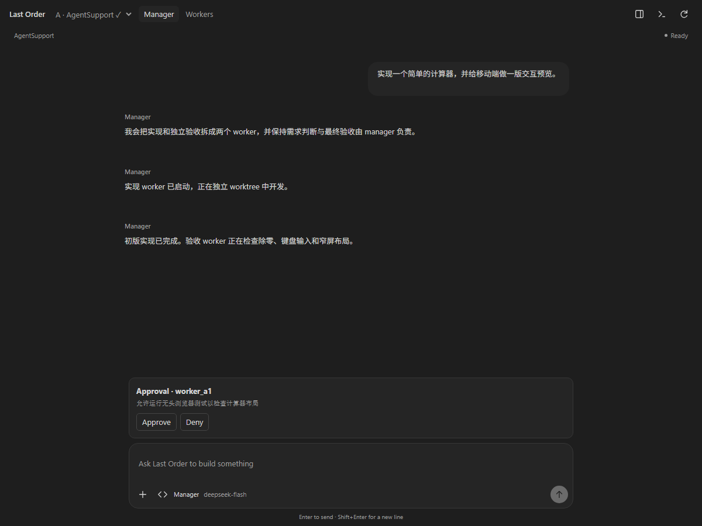
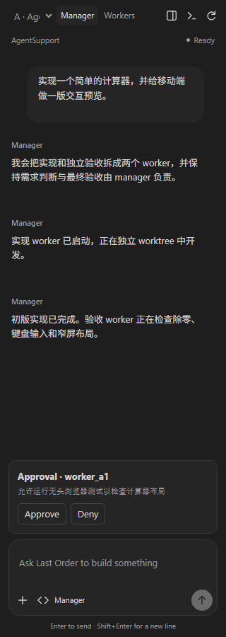
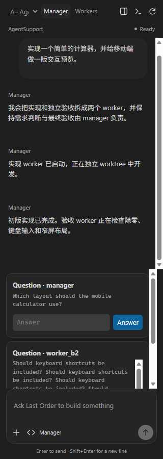
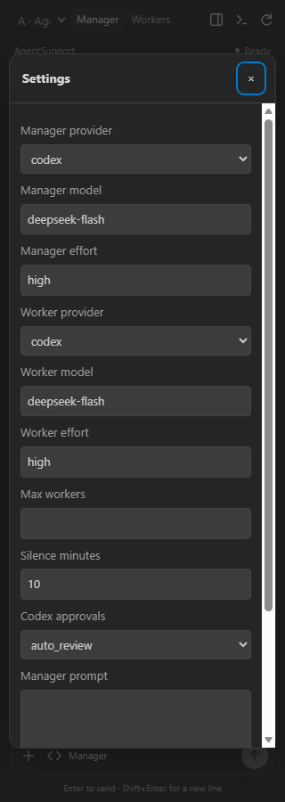

# Webview 0.1.74 candidate review

Status: development checks passed; visual acceptance in VS Code Remote remains pending.

The Manager now centers the conversation and Composer in a 760px column. Session statistics, worker summaries and queue details live in a panel opened from the header, including at narrow sidebar widths. User messages use a quiet bubble; assistant messages use the conversation canvas. The Composer combines message input, attachments, quotes, model context and send/interrupt actions in one surface.

## Visual reference and tokens

Reference: the installed Codex extension `openai.chatgpt-26.1021.22027-win32-x64`, specifically its `app-initial`, `composer-layout`, `user-message-bubble` and `thread-layout` CSS assets. This establishes a code-based reference, not an approved side-by-side visual match. No OpenAI assets were copied into Last Order.

| Element | Candidate rule |
| --- | --- |
| Font | VS Code UI family and font size, 13px fallback; line height 1.6 |
| Spacing | 4px base; 16–24px conversation gutters; 28px message separation |
| Conversation | 760px maximum width; user bubble aligned right; assistant text aligned left |
| Surface | Theme background and foreground; 4% foreground tint for quiet surfaces |
| Border | 14% foreground mix; VS Code contrast border in high contrast |
| Corners | 16px Composer and user bubble; 10px approval cards; 12px sheets |
| Controls | 30px icons and send action; focus-visible theme outline |
| Composer | 52–168px input; toolbar below; approvals scroll within 26vh |
| Sidebar | 320px checked; details become an overlay; settings labels stack |

## Development evidence

Run `node scripts/verify-webview.mjs`. On Windows it uses installed Edge; set `WEBVIEW_BROWSER` to override the executable. It opens a dedicated headless browser profile under `.tmp/webview-review`, drives DevTools mouse/keyboard input, and writes screenshots plus `results.json`. It uses simulated bridge data and must not count as real backend or Remote host acceptance.

26 layouts passed bounds, overflow and runtime-error checks. Eight interaction checks passed: session details, multiline send, failed-send draft preservation, approval, denial, question response, worker pause routing, and modal keyboard focus. Approval/question responses also check that their pending requests resolve.

| Page/state | Visual review observations | Remaining acceptance |
| --- | --- | --- |
| Manager desktop, 680, 504, 320px | Conversation owns the canvas; no always-on dashboard rail; Composer aligns to conversation column | Real Codex side-by-side at actual Remote sidebar width |
| Empty, connecting, unavailable | Distinct messages; successful connection replaces loading text; errors disable sending and offer Refresh | Actual failed backend startup and retry |
| Working, interrupted, provider error | Working indicator and interrupt control; explicit held state; one error card | Real provider lifecycle |
| Long history | Wrapped paths, scrolling conversation and pinned Composer | Live incremental output and scroll retention |
| Approvals, long commands, resolved cards | Rounded cards, constrained detail scroll, action buttons remain available | Real approval outcomes and multiple actors |
| Questions | Narrow inputs stay inside cards; multiple cards scroll above input | Structured multi-question choices remain to be reviewed |
| Worker conversation | List, header, controls, folded activity and result remain accessible | Status matrix, archive, takeover/handback and long history |
| Workspace, Git | Navigation and mode controls fit 320px; file rows and diff remain readable | Empty/loading/error states, large diff, actual editor opening |
| Settings | Labels stack at 320px; prompt/settings scroll within modal | Invalid values, long prompt, save/restart lifecycle |
| Commands | Quiet rows with descriptive text; chevron stays beside each row | Full shortcut/slash command behavior in host |
| Checkpoints, turns, skills, version | Consistent sheet layout and wrapping at 320px | Empty/error/disabled states and actual restore/fork/revert |
| Quote, multiline, send failure | Context remains in Composer; successful send clears draft; failure retains draft | Actual attachments, selection insertion, slash/history |
| Light, high contrast, 18px font | Theme surfaces adapt; contrast borders and scaled typography visible | Actual host theme switching and zoom |

Selected development screenshots:

## Interaction fixes

- Approval and question entity IDs previously overwrote the API request sequence. Replies could not resolve the pending request. Entity IDs now use `approvalId` and `questionId`.
- Worker controls previously overwrote the `controlWorker` API name with `pause`/`resume`/etc. They now use `workerAction`, which the extension forwards as the backend action.
- Empty-thread rendering now accounts for connection state, so a connected empty session leaves the connecting screen.
- Refresh retries initialization after a startup failure. Modal focus is contained and restored; global shortcuts do not change the underlying page while a sheet is open.

The routing regression test executes the Webview request function and the extension API handler together, checking the actual backend path, payload and response correlation.

## Build and host limitation

- `npm.cmd test`: 147 passed.
- `npm.cmd run check`: passed.
- Candidate VSIX: `vscode-extension/last-order-vscode-0.1.74.vsix`, 80 files, approximately 202 KB.
- A real isolated VS Code development host was attempted using a workspace-local profile. Startup reported `checkInnoSetupMutex: vscode-updating still held after 31401ms, giving up`, then `Code is currently being updated`. The temporary debugging endpoint exposed no workbench before exit. No real Webview host screenshot was obtained.

The next acceptance step is to install the candidate in the Linux Remote environment, reload the window, run a real task, and compare Manager and Composer with Codex. Complete that gate before widening the redesign or declaring the handoff's full page/state matrix passed.
