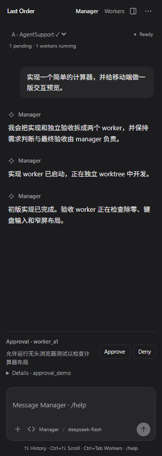
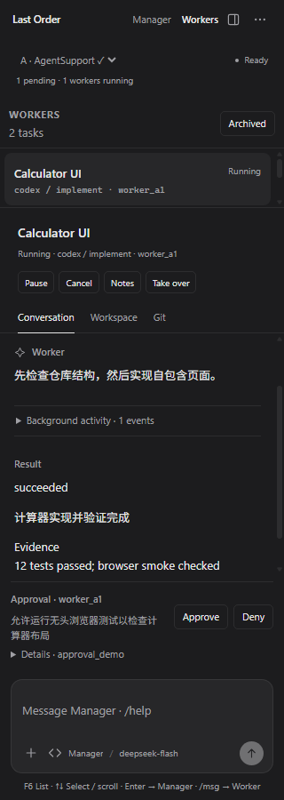

# 0.1.75 — A 风格与 TUI 操作保持一致

用户选定 A「墨黑 · 极简对话」，并明确 Webview 迁移仅为解决性能问题。内容设计、消息路由和键盘操作以 `src/ui.js` 的 TUI 为准。

## 已落实

- 墨黑背景、低对比细线、用户消息气泡、助手正文和简洁输入框；不增加欢迎大标题或任务看板。
- 两页均保留项目、Manager 状态、待处理数量和运行中 Worker 数量；Workers 保留列表与对话/文件/Git 详情。
- 审批、问题、排队消息位于输入区上方；完整请求可展开，也可用原来的 slash 命令查看。
- 两页共享输入草稿和历史。普通消息始终发给 Manager；只有 `/msg worker_id 消息` 发给 Worker。修正此前 Webview 按当前 Worker 自动改变接收者的行为。
- 与 TUI 共用 `src/commands.js` 的命令目录和补全逻辑，支持命令、Worker、审批、问题、文件、skill 和项目候选。候选单行显示，Tab 只填入，Enter 执行当前输入。
- 原生 Webview 内的确认与标签输入使用可聚焦表单，支持 Tab、Enter、Esc，不依赖浏览器原生 confirm/prompt。

## 键盘

| 按键 | 行为 |
| --- | --- |
| Ctrl+Tab | 切换 Manager / Workers，共享输入不丢失 |
| F1 / F2 / F3 / F4 | Manager / Worker 对话 / 工作区 / Git |
| F5 | 展开/折叠当前 Worker 对话后台过程 |
| F6 | 切换 Worker 列表与详情焦点 |
| ↑↓ | Manager 输入历史；Worker 输入为空时选择任务或滚动详情 |
| ←→ | Worker 输入为空时切换对话/工作区/Git |
| Ctrl+↑↓ / PgUp / PgDn | 滚动当前内容 |
| Shift+↑↓ / Ctrl+Home / Ctrl+End | 顶部/底部 |
| Ctrl+P / Ctrl+N / Ctrl+U | 历史前后/清空输入 |
| Enter / Ctrl+Enter / Shift+Enter | 发送/换行/换行 |
| Ctrl+Q | 将选区插入引用 |
| Alt+↑↓ | 在项目选择器中浏览，Enter 切换 |
| Tab / ↑↓ / Esc | 填入/选择/收起命令候选 |
| Esc | 退出弹层；Worker 返回 Manager |
| Ctrl+S | Settings 保存 |

## 渲染性能与验证

对话更新按 actor/事件序号复用消息节点。既有消息不重新解析 Markdown，不移除后重建；工具组沿用展开状态，原生文本选择保留。没有变化的 Worker 列表和操作按钮跳过重建。输入框内容、宽度和字号不变时，不重复测量高度。

- `npm.cmd test`：147 项通过。
- `npm.cmd run check`、Webview/扩展 JS 语法检查通过。
- `node scripts/verify-webview.mjs`：26 个浏览器布局、17 组交互检查通过，覆盖原 TUI 的发送路由、共享输入、历史、Tab 补全、焦点、滚动、折叠和 slash 操作。
- 模拟 87 条历史的 20 次增量更新：本次记录为 31ms，既有消息节点与文本选区均保留。这是开发浏览器中的同步更新耗时，不是实际 provider/Remote 性能基准。
- 候选包：`vscode-extension/last-order-vscode-0.1.75.vsix`。

完整浏览器截图与指标位于 `.tmp/webview-review/`，交互预览位于 `.tmp/webview-preview.html`，均使用模拟桥接数据。

仍需实际 VS Code Remote 安装、真实任务、宿主快捷键和端到端性能验收。上一轮本地开发宿主因 VS Code 更新锁无法启动，此轮不把浏览器检查标记为真实宿主验收。
