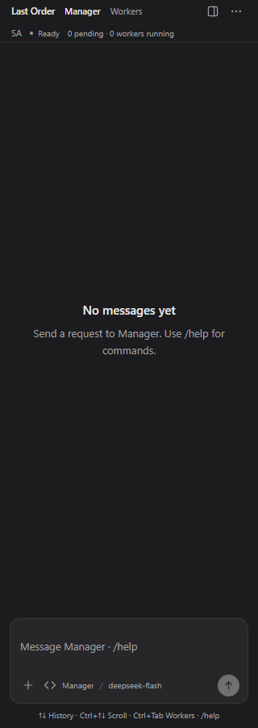
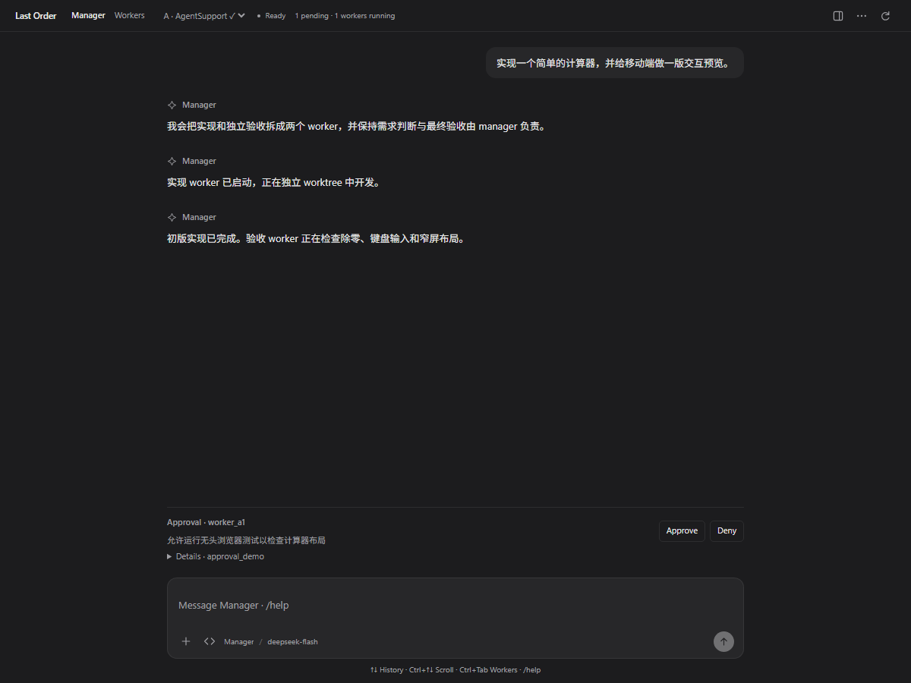

# 0.1.76 顶栏布局纠正

0.1.75 虽已恢复 TUI 的命令和消息路由，但将品牌/导航、项目和运行计数拆为三个纵向区块，未按用户要求保持紧凑。此次将这些元素归入同一个 header，不再单独居中。

- 大于 900px：品牌、Manager/Workers、项目、状态、计数、工具按钮同一行。
- 900px 及以下：品牌/导航/工具一行，项目/状态/计数同行，统一左对齐。
- 原 TUI 的键盘操作和消息路由保持不变。

开发检查新增单项目 SA、Ready、零任务场景，并对全部布局检查顶栏高度以及项目、状态和计数的纵向中心是否一致。27 个布局、17 组交互检查通过；扩展/Webview 的 3 项相关测试通过。

以上为 Edge 模拟数据开发截图，真实 VS Code Remote 宿主验证仍待完成。候选包：`vscode-extension/last-order-vscode-0.1.76.vsix`。
