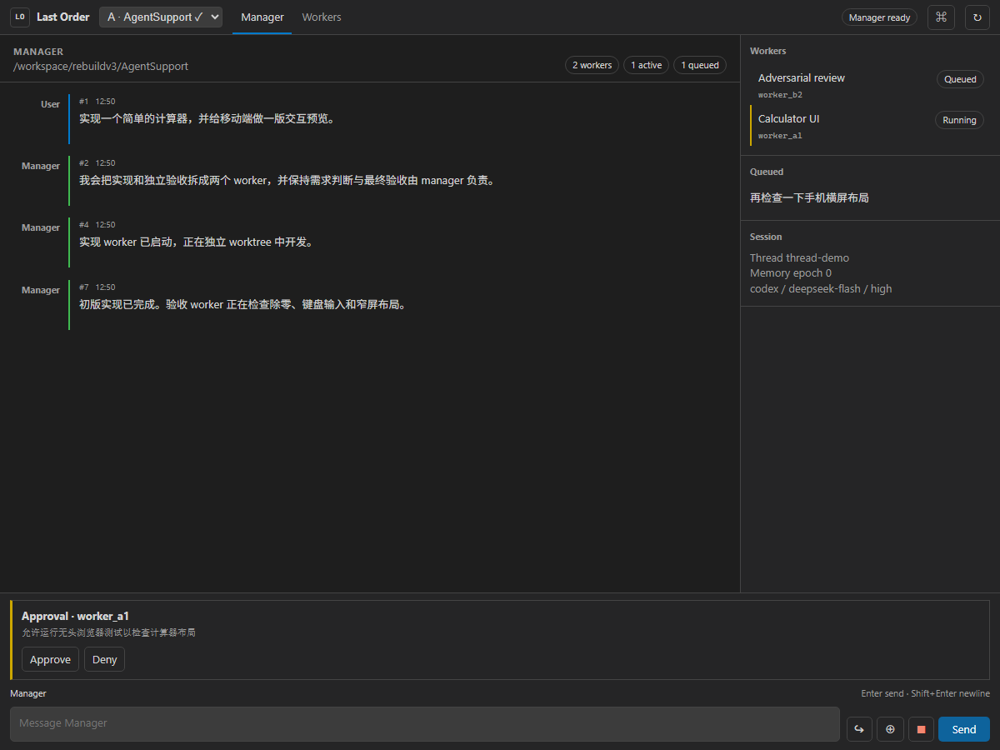
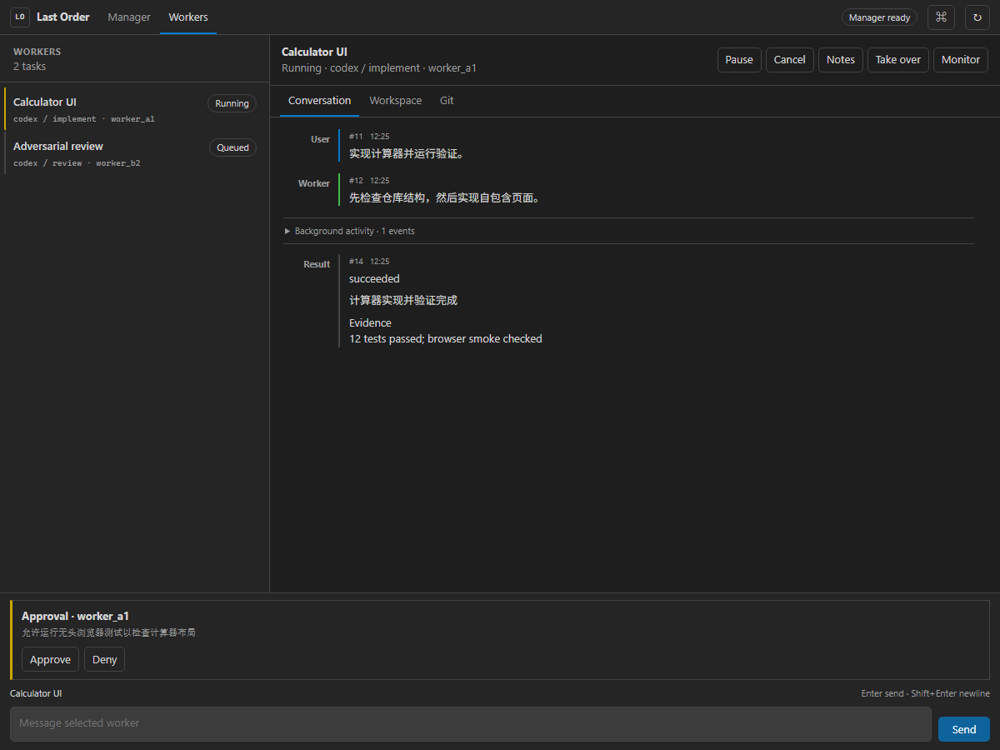
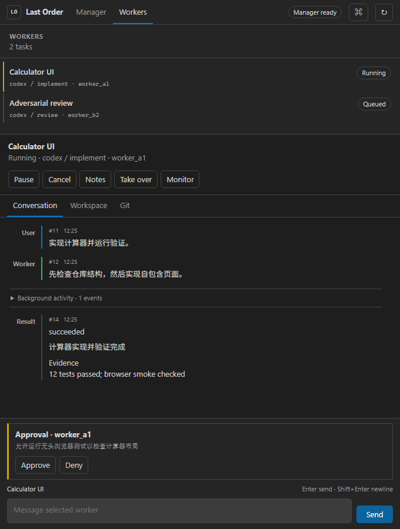
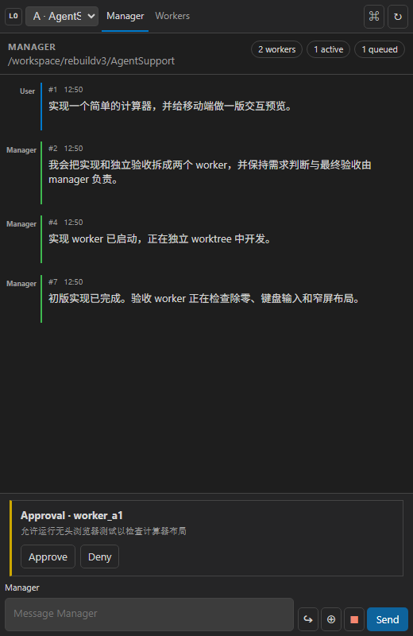
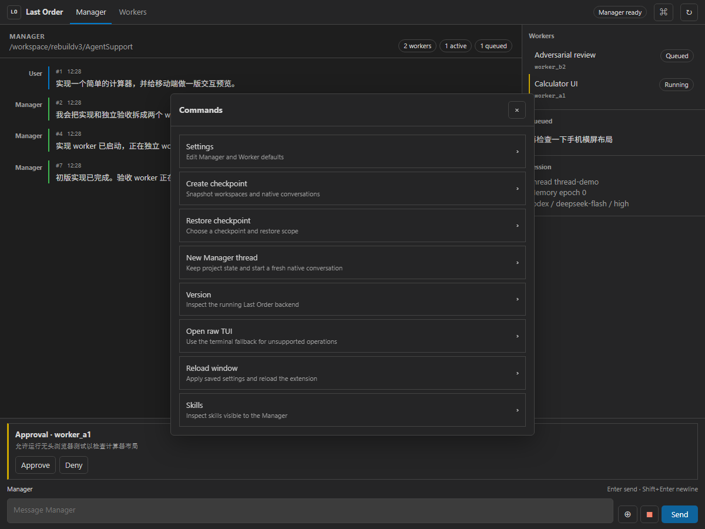
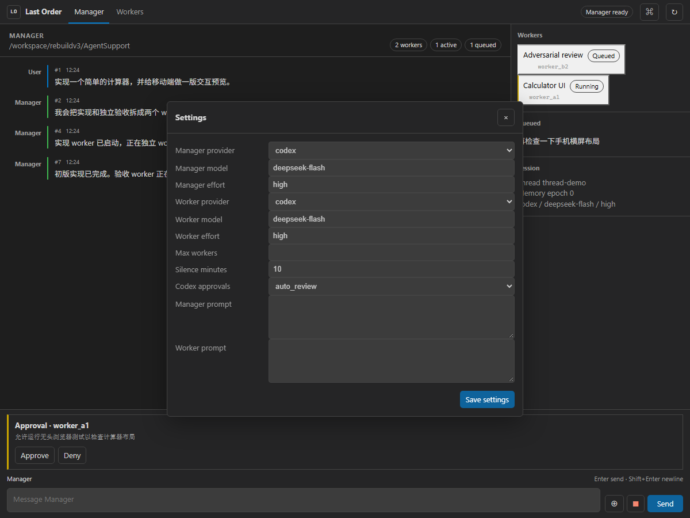
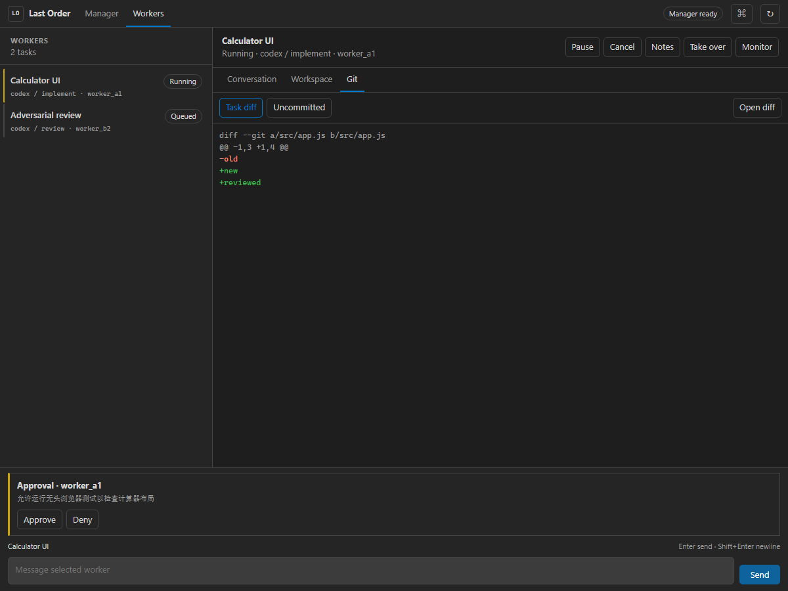
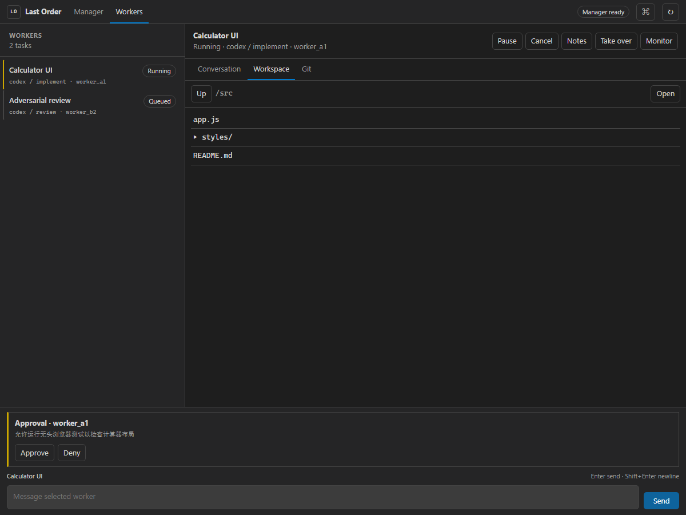
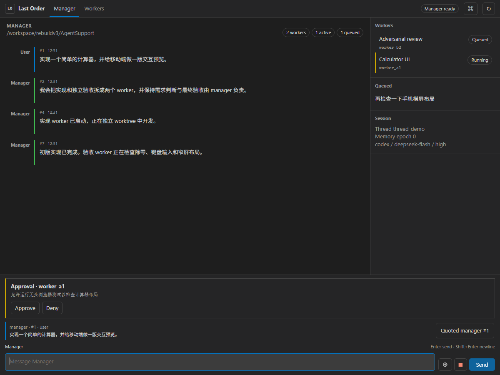
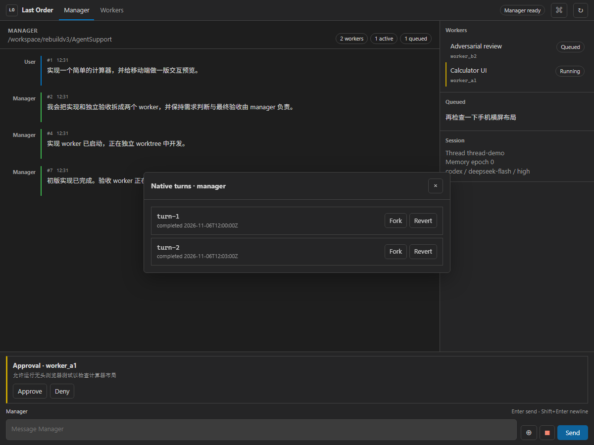

# Native Webview UI Verification

> Historical 0.1.73 browser-only development evidence. These screenshots do not establish VS Code Remote visual acceptance. See [0.1.76 header correction](webview-ui-0.1.76.md) and [0.1.75 TUI keyboard review](webview-ui-0.1.75.md) for current changes and outstanding acceptance work.

Rendered with the bundled Edge headless browser from the same HTML, CSS, and JavaScript packaged in the extension.

## Screenshots

### Manager, 1200 x 900

Verified: Manager/Workers navigation, multi-project selector, fixed Composer, queue summary, worker summary, approval actions, message hierarchy, and no overlap between scrolling content and the Composer.

### Worker conversation, 1200 x 900

Verified: worker list, selected worker detail, fixed Composer target, worker controls, conversation tabs, folded background activity, and global approval area.

### Worker conversation, 680 x 900

Verified: Workers stack vertically at narrow width, controls wrap within the detail header, and the Composer remains pinned at the bottom without horizontal overflow.

### Manager sidebar, 504 px viewport

Verified with the minimum viewport width supported by the headless Edge runner. The sidebar keeps the compact project selector, drops the secondary activity rail, hides nonessential topbar text, wraps long messages, and preserves the fixed Composer without horizontal overflow.

### Commands and settings

Verified: modal sheets use an opaque themed surface, long settings content scrolls inside the sheet, labels and controls remain aligned, and the bottom Composer stays outside the modal.

### Git diff

Verified: task/uncommitted modes are visible, added and removed lines use distinct theme colors, the diff fills the detail pane, and approval/Composer regions remain fixed.

### Workspace files

Verified: directory navigation, file list, an editor-open action, and the fixed Composer remain usable together.

### Quoted history

Verified: quoted actor/sequence/role are preserved, the quote tray sits above the Composer, and the Composer remains fixed and usable.

### Native turns

Verified: provider-native turns display inside the Webview with explicit Fork and Revert actions.

## Automated checks

- `test/webview-ui.test.js` verifies the native HTML/CSS/JS assets, Manager and Workers surfaces, fixed Composer, bridge actions, settings and command sheet, and JavaScript syntax.
- `test/vscode-extension.test.js` resolves the real Webview provider with a fake VSCode host and verifies that the generated HTML has CSP and resource placeholders replaced.
- `npm.cmd test` passes all 146 automated tests.

Visual checks also caught and fixed a Worker Composer that remained disabled after selecting a worker, a single-line textarea scrollbar artifact, serif font fallback, and transparent modal backgrounds when VS Code theme variables were not yet available.

The final sidebar pass also verifies the editor-context action at a 504 px viewport. The extension no longer packages xterm or a terminal host; the VSIX contains only the native Manager Webview plus the Mission Control backend and Git Diff integration.
